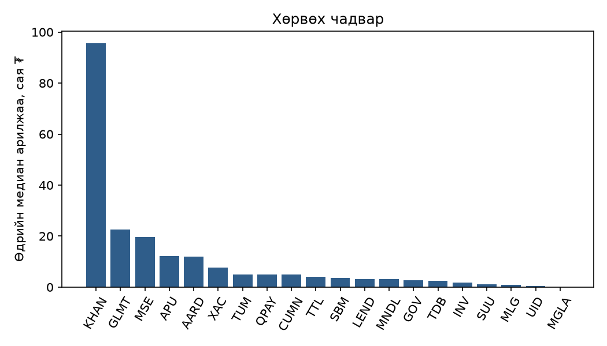
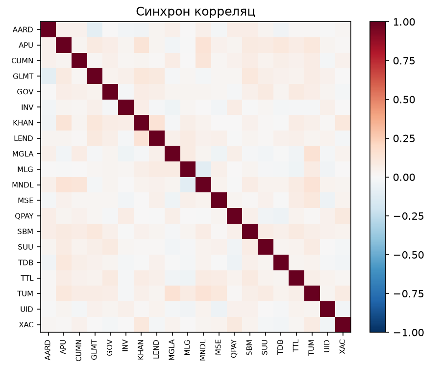
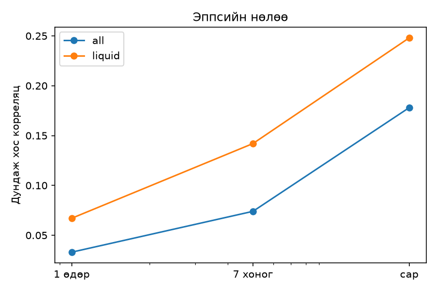
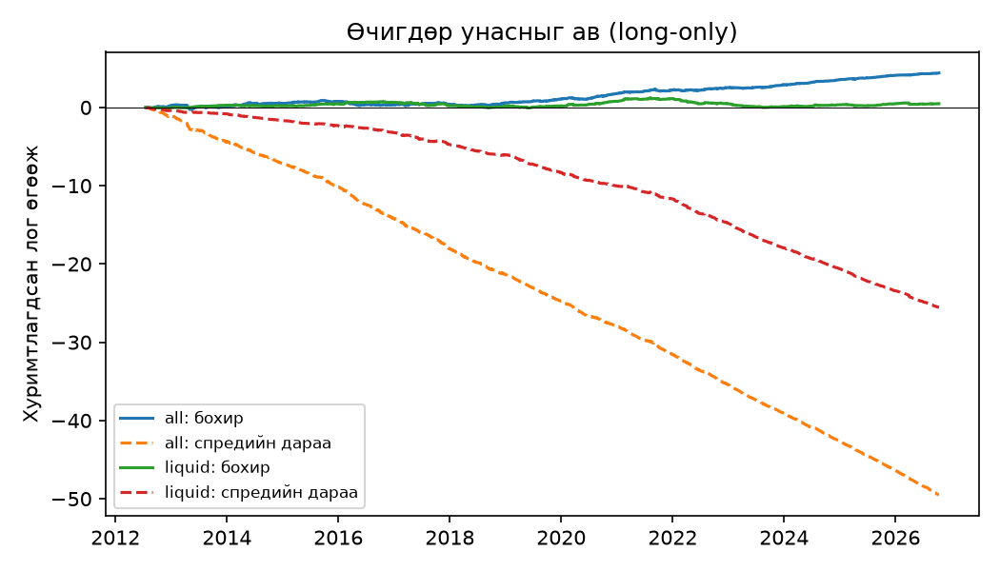

# Microstructure of a Frontier Market: Mongolian Stock Exchange TOP-20

An empirical study of daily trading data for the 20 constituents of the Mongolian Stock Exchange (MSE) TOP-20 index, 2012–2026. It covers data validation, liquidity and transaction costs, return dependence, the Epps effect, a "spurious alpha" test, and an event study of the ±15% daily price limit.

*Монгол хураангуй доор байна → [Монгол хэлээр](#монгол-хураангуй)*

---

## Key findings

| # | Finding | Evidence |
|---|---------|----------|
| 1 | **Liquidity explains serial correlation.** Illiquid names show strongly negative lag-1 autocorrelation (bid–ask bounce). Liquid names show slightly positive autocorrelation (slow price adjustment). | Spearman ρ(liquidity, ACF1) = 0.66, p = 0.002. ACF1: INV −0.32, TDB −0.28, MLG −0.26 vs MSE +0.14. Variance ratio VR(5) z: INV −5.7, UID −5.7 vs AARD +5.3. |
| 2 | **Low daily correlation is an artefact of asynchronous trading (Epps effect).** | Liquid names: average pairwise correlation is 0.067 at 1 day, 0.142 at 1 week and 0.248 at 1 month. PC1 share rises from 23% to 41%. |
| 3 | **Short-term reversal "alpha" is the bid–ask spread.** | Long-only "buy yesterday's losers": gross +13.4 bp/day, t = 4.6, Sharpe 1.29. Net of spread: −151 bp/day. On liquid names gross is only 2.1 bp, t = 0.6. |
| 4 | **Realistic round-trip cost** is about 0.6–0.9% for the most liquid names and 2–3% for the rest, before commission. | Abdi–Ranaldo and Roll estimators agree on illiquid names. |
| 5 | **The ±15% daily price limit has been constant since 2012.** Continuation after limit hits happens *overnight*, so it cannot be captured. | The next open gaps up by +8.2% on average, and in 43% of cases opens at the limit again. From the next open, the 1-day return is ≈ 0. |
| 6 | **Hypothesis (post hoc):** limit-up runs that end with a limit-open overshoot and reverse. Most are IPO/listing pops. | 10/10 such episodes fell, with a 5-day mean of −17%. Examples: SBM 2022, MSE 2023, KHAN 2023. Selected after seeing the data, so this needs out-of-sample confirmation. |
| 7 | **No mean return is statistically significant.** | Maximum t = 1.9. At 40% volatility, detecting 20% per year at t = 2 requires about 16 years of data. |

### Figures

| Liquidity | Daily correlation |
|---|---|
|  |  |

| Epps effect | Reversal: gross vs net |
|---|---|
|  |  |

---

## Repository layout

```
src/
  mse_history.py    download daily trade history from open.mse.mn → mse_<TICKER>_<start>_<end>.csv
  mse_analysis.py   stage 1: quality, liquidity, return distribution, ACF/Ljung–Box/variance ratio,
                    weekday effect, correlation, PCA, Dimson beta          → report/
  mse_deep.py       stage 2: event list, Abdi–Ranaldo spread, Epps effect,
                    long-only reversal backtest, GARCH(1,1)               → report2/
  mse_limits.py     stage 3: ±15% price-limit event study                 → report3/
notebooks/
  mse_pipeline.ipynb   all four stages run end-to-end, with outputs
report/ report2/ report3/   result tables (CSV) and figures
```

## Reproduce

```bash
pip install -r requirements.txt
python src/mse_history.py ALL 2010-01-01 2026-10-14   # downloads the raw CSVs into the current folder
python src/mse_analysis.py 2010-01-01 2026-10-14
python src/mse_deep.py     2010-01-01 2026-10-14
python src/mse_limits.py   2010-01-01 2026-10-14
```

Raw price files are **not** committed. They are public market data from [open.mse.mn](https://open.mse.mn) and can be re-downloaded with `mse_history.py`, which waits 1 s between requests.

## Methods

**Returns**
- Close-to-close log returns are measured over the actual gap between trades ("gap-aware").
- Days with |r| > 30% are treated as splits or errors and removed. The splits are APU 2016-06-20, SUU 2016-06-20 and GOV 2018-12-14.

**Liquidity**
- Share of days traded, median traded value, and Amihud illiquidity.
- Roll (1984) spread.
- Abdi & Ranaldo (2017) close–high–low spread.

**Dependence**
- Ljung–Box test.
- Lo & MacKinlay (1988) variance ratio with heteroskedasticity-robust z.
- Ljung–Box on |r| to detect volatility clustering.

**Cross-section**
- Pairwise correlation and PCA.
- Dimson (1979) beta against a leave-one-out equal-weight index of liquid names (median value ≥ 5m ₮ and traded on ≥ 90% of days).

**Epps effect**
- Non-overlapping 1-, 5- and 20-business-day returns on a forward-filled business-day grid.

**Reversal backtest**
- Buy all names that fell today at the close and sell at the next close.
- Cost is one full Abdi–Ranaldo spread per day. This is conservative.

**Limit study**
- Entry at the next day's open, because the limit-day close is not executable.
- Holding periods of 1, 2 and 5 days.
- Consecutive limit days are grouped into episodes.

## Limitations

- Prices are **not adjusted for dividends**. Many of the largest single-day drops cluster in early April, consistent with ex-dividend dates (e.g. KHAN). These still need to be matched against corporate-action announcements.
- `bdate_range` ignores Mongolian public holidays, so "% days traded" is slightly understated. A few weekend trading days exist (make-up working days).
- Rows with zero high/low produce `log(0)` warnings. This affects the full-sample Abdi–Ranaldo estimate for AARD (reported as 0).
- GARCH(1,1) with Gaussian QML hits the parameter boundary for KHAN and GLMT (fat tails, limit hits, ex-dividend jumps). A Student-t GARCH is planned.
- Short selling is effectively unavailable on the MSE, so any "short" leg is informational only.
- Liquidity is a full-sample label. A stock that was illiquid early in its history may be labelled liquid.

## Next steps

- Adjust prices for dividends using MSE corporate-action data, then rerun the analysis.
- Pre-register the limit-overshoot hypothesis and test it on future IPOs.
- Build a weekly-frequency covariance model and compare out-of-sample minimum-variance and equal-weight portfolios.

## Author

Chuluunbold, BSc Applied Mathematics (Statistics minor), National University of Mongolia, 2026.

Code comments and console output are in Mongolian.

## License

MIT. See [LICENSE](LICENSE).

---

## Монгол хураангуй

МХБ-ийн TOP-20 индексийн хувьцаануудын 2012–2026 оны өдрийн арилжааны өгөгдөл дээр хийсэн бичил бүтцийн судалгаа.

1. **Хөрвөх чадвар нь автокорреляцыг тайлбарладаг.**
   - Бага арилжаалагддаг хувьцаанд acf1 сөрөг: INV −0.32, TDB −0.28. Энэ нь bid-ask bounce буюу ханш худалдан авах, худалдах үнийн хооронд үсэрч байгааг илтгэнэ.
   - Хөрвөх чадвартай хувьцаанд acf1 бага зэрэг эерэг: MSE +0.14.
   - Хоёрын хоорондох Spearman корреляц ρ = 0.66.
2. **Өдрийн корреляц бага гарах нь Эппсийн нөлөө.** Хөрвөх чадвартай 6 хувьцааны хосуудын дундаж корреляц 1 өдрийн өгөөжөөр 0.067 байгаа бол сарын өгөөжөөр 0.248 болдог.
3. **«Өчигдөр унасныг ав» стратеги бол хуурмаг альфа.** Бохир өгөөж өдөрт +13 б.н. (t = 4.6) боловч спредийг хассаны дараа өдөрт −151 б.н. болно.
4. **±15%-ийн хязгаар 2012 оноос хойш өөрчлөгдөөгүй.**
   - Хязгаарт хүрсний дараах үргэлжлэл бүхэлдээ шөнийн дотор болдог: маргааш ханш дунджаар +8.2%-иар цоорхойтой нээгддэг тул энэ хөдөлгөөнийг барих боломжгүй.
   - Хязгаар дээрээ нээгдсэн цувааны дараа ханш буцаж унадаг: IPO-гийн 10 тохиолдлын 10-д нь 5 хоногийн дундаж уналт −17%. Энэ дэд бүлгийг өгөгдлийг харсны дараа сонгосон тул ирээдүйн шинэ IPO-нууд дээр шалгах шаардлагатай.
5. **Аль ч хувьцааны дундаж өгөөж статистикийн хувьд ач холбогдолгүй.**

Түүхий өгөгдлийг энэ repo-д оруулаагүй. `src/mse_history.py`-аар дахин татаж болно.
